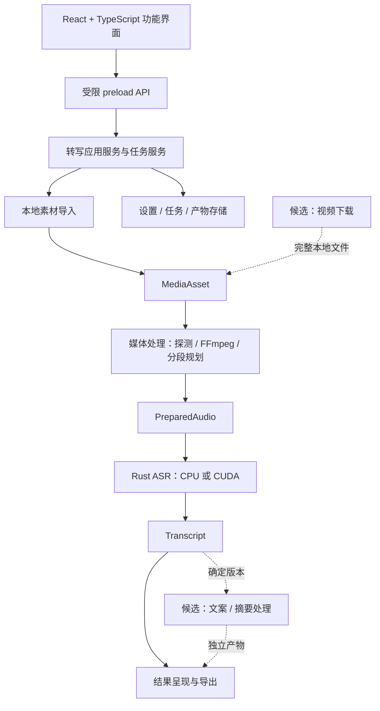

# Voco 模块化架构与实施总计划

日期：2026-11-07。目标仓库：[bioone/Voco](https://github.com/bioone/Voco)。

状态：设计与准备阶段。本文件规定后续实现的边界和验收条件，不表示这些模块已经实现。`main` 承载新方案及后续 Rust + Electron + TypeScript 开发；旧版源码保留在 `legacy/electron-python`，旧软件包保留在 `release/win-unpacked/`。

配套文件：[推理、官方样本与测试细则](rust-electron-ts-plan.md)、[旧包完整校验清单](legacy-package-manifest.json)、[官方样本清单](../tests/fixtures/qwen3-asr/manifest.json)。发生设计冲突时，本文件负责模块边界与阶段范围，测试细则负责样本、质量门槛和测试记录；修改时同步两份文件。

## 1. 产品范围

### 当前确认的核心

交付 Windows 本地桌面软件：用户选择 Qwen3-ASR 权重目录，导入本地音频/视频，选择自动、CPU 或 NVIDIA GPU，获得可保存的转写结果。软件内含 FFmpeg、推理程序及必需运行库，ASR 不依赖 Python 或云端服务。

当前核心包括：

1. 本地媒体导入、音轨探测、音频规范化和有界分段。
2. Rust + Candle 加载本地 Qwen3-ASR-0.6B；分别验证 CPU/CUDA。
3. 队列、阶段进度、取消、失败提示、重试和历史记录。
4. 查看完整文本与分段结果，导出 TXT、JSON、Markdown 和片段级 SRT/VTT。
5. 设备/模型/FFmpeg 能力检测，独立的新版设置与产物目录。
6. 官方中英样本、实际桌面应用和最终软件包的分层测试。

旧版 TTS 与声音库保留。新界面如继续提供这些功能，通过兼容适配器调用现有 Python 后端；缺少该环境不能阻止 ASR 工作。PDF/OCR 不在本轮迁移范围。

### 后续候选，不是当前交付承诺

| 候选能力 | 现在只确定的接入点 | 实施前还需确定 |
| --- | --- | --- |
| 视频下载 | 完整、已校验的下载文件登记为 `MediaAsset`，接入既有媒体处理流程 | 目标来源、下载工具、格式、用户交互、更新和凭据管理方式。 |
| 文案处理 | 读取某个确定版本的转写结果，生成独立文本产物 | “文案转写”的具体产品含义，例如整理、改写或生成；模型与质量标准。 |
| 摘要、观点与章节 | 读取转写稿及时间信息，生成可追溯的派生内容 | 本地模型/运行时、长文策略、内容完整性和事实核对门槛。 |
| 精确字幕 | 对转写和对应音频做独立对齐，产生新的时间戳版本 | ForcedAligner 的 Rust 接入、语言范围、准确度和资源要求。 |
| 画面理解 | 独立读取视频画面并输出带来源位置的结果 | 是否需要此功能、抽帧、视觉模型及评价方法。 |

当前不创建下载/文案空页面、空 crate、通用插件系统或通用工作流编辑器。候选功能被移除或延期时，核心 ASR 仍完整成立。下载、文案和总结的后续实现须先补充相应功能定义与验收方案。

## 2. 架构选择与依赖方向

采用一个按功能划分模块的桌面应用，模型推理以子进程隔离。Electron 主进程负责应用编排与本地媒体处理，Rust worker 负责 ASR。各功能以明确的数据契约连接。



FFmpeg 从 ASR worker 中分离，理由是媒体转换不需要 CUDA；这样无显卡环境可独立处理媒体，将来添加下载来源也不需要修改模型代码。设备子进程隔离保留：同包包含 CPU 和 CUDA worker，二者复用同一 Rust 实现，区别仅在构建 feature 和设备能力。

第一版不拆为微服务或大量 npm 包/crate。先用目录、公开接口、运行时校验和依赖检查约束边界；仅在出现独立分发、独立依赖冲突或明确复用需求时再考虑拆包。

## 3. 模块职责与数据归属

| 模块 | 负责 | 不负责 |
| --- | --- | --- |
| `renderer/features` | 转写、任务、设置、既有合成/声音库的页面与交互 | 文件系统、进程、模型加载、业务状态持久化。 |
| `preload` | 暴露固定业务 API、转发允许的事件、隔离 Electron 权限 | 通用 `exec`、任意文件读写、透传整个 IPC 对象。 |
| `application` | 转写流程顺序、任务状态、阶段协调、取消与重试策略 | FFmpeg 参数、模型算子、特定下载平台逻辑。 |
| `media` | 本地素材授权与登记、媒体探测、选音轨、FFmpeg 转换、时间映射与分段规划 | ASR、总结、任意 URL 下载。 |
| `asr` | TS 侧 worker 适配器；Rust 侧权重校验、精度/设备、按段读取与推理 | 下载、用户界面、直接改写任务历史、导出排版。 |
| `results` | 原始转写版本、用户可见文本与时间片段、纯导出格式化 | 为导出重新启动推理、用摘要替换原始转写。 |
| `infrastructure` | 配置/任务仓储、产物落盘、进程树管理、运行库定位与能力探测 | 决定任务成功或把业务规则堆进通用工具。 |
| `shared/contracts` | IPC 与 TS/Rust 边界 DTO、版本、字段单位与校验样例 | Node/Electron/CUDA/网络依赖及实现代码。 |

**唯一写入责任：**

- `JobService` 决定并持久化任务/阶段状态。UI 和 worker 只提出请求或报告事件，不直接写历史。
- `ArtifactRepository` 分配阶段输出目录，验证并登记成功产物。FFmpeg/Rust 在分配的目录里产生待验收文件，不能自行宣布任务已持久成功。
- 原始 `Transcript` 保存为独立、不可被派生功能覆盖的结果版本；编辑或候选文案处理产生新版本/新产物，并保留来源关系。
- 本地原文件归用户所有，只读访问；下载文件（未来）、中间文件、应用生成结果分别标记所有权与保留策略。

仅允许以下依赖方向：`renderer → preload API → application → 功能接口/基础设施适配器`。`media`、`asr`、导出不能相互导入实现；由应用服务协调。`shared/contracts` 保持无平台依赖。组装入口可以引用具体实现，业务服务通过有限的构造参数接收依赖，不引入通用依赖注入框架。

## 4. 边界数据与接口

以下是设计约束，不是已发布 API；M1 实施时固化为可校验的协议 v1 和 TS/Rust 双方样例。

| 数据 | 必需信息 | 约束 |
| --- | --- | --- |
| `MediaAsset` | `assetId`、原始名称、本地文件身份、来源类别、文件大小、可空的探测结果 | 导入后探测结果为空；探测成功才包含媒体属性与音轨。主进程保管真实路径，渲染进程使用资源 ID；输入身份用于检查处理中源文件是否变化。 |
| `PreparedAudio` | `artifactId`、源 `assetId`、16 kHz/mono/PCM16 格式、总采样数、音轨 ID、分段采样区间、源时间映射、预处理版本/参数 | 分段以采样索引为准，保留对应源媒体时间；ASR 接口只接本地规范化音频，不接 URL。 |
| `Transcript` | `transcriptId`、版本、源资源与音轨、文本、片段、语言、模型标识、请求/实际设备、实际精度、警告、耗时 | 每个片段携带 `startMs/endMs` 与 `timeKind`；片段时间和精确对齐明确区分。 |
| `Artifact` | `artifactId`、种类、所属任务/阶段/尝试、来源结果版本、相对存储位置、大小/校验值、schemaVersion | 只登记验证完成的产物；未完成的临时文件不能被结果页面当作成功结果。 |
| `JobSnapshot` | 任务 ID、状态、阶段、进度、尝试编号、错误码/消息、结果引用、警告 | 它是任务服务状态的只读视图，不允许 UI 直接提交一个“已成功”的快照。 |

时间统一为源媒体播放起点对应的毫秒；分段样本区间用闭开区间。媒体层保留音轨起点、裁剪和重采样产生的映射，ASR 不按段号猜测源时间。文本完整性、时间范围和编码都要在发布结果前校验。

`importLocalMedia` 只完成文件授权、基本校验和资源登记；`probeMedia` 成功后写入该资源的探测结果。`prepareAudio` 必须拒绝未探测成功或音轨选择无效的资源，避免导入阶段反过来依赖尚未执行的媒体探测。

### 核心操作

| 接口 | 输入 → 输出 | 执行位置 |
| --- | --- | --- |
| `importLocalMedia` | 原生选择授权 → `MediaAsset` | Electron media 模块。 |
| `probeMedia / prepareAudio` | 本地资源 + 音轨/预处理选项 → 媒体信息 / `PreparedAudio` | Electron media + 内置 FFprobe/FFmpeg。 |
| `transcribe` | `PreparedAudio` + 模型/语言/设备设置 → 待验收 `Transcript` | Rust worker，经 ASR 适配器调用。 |
| `exportResult` | 确定的结果版本 + 格式 + 原生保存授权 → 导出文件 | results 格式化 + ArtifactRepository。 |
| `startJob / cancelJob / retryJob` | 类型化请求 → `JobSnapshot` / 进度事件 | 应用服务。 |

Rust JSONL 包含 `protocolVersion`、`jobId`、`attemptId`、事件类型和载荷。`progress` 不能当作成功；成功需要合法结果、进程退出码为 0、产物校验通过。大文本通过受控结果文件传递，事件只带受限的进度与引用，防止超长协议行。旧 Python TTS 继续由兼容适配器按原协议接入。

边界错误使用稳定错误码与可读消息，例如输入损坏、媒体无音轨、FFmpeg 缺失、模型不匹配、CUDA 不可用、显存不足、取消、输出失败。调用方依据错误码执行预先定义的策略，不能解析日志文本猜测是否应回退 CPU。

## 5. 流程、恢复与资源

当前采用固定阶段流程：`导入 → 探测/选音轨 → 准备音频 → 转写 → 校验并保存`。导出使用已保存结果，可以多次执行，无需再次推理。阶段枚举保持小而明确，不先实现任意 DAG、第三方插件或可视化工作流。

- 第一版保持串行转写/模型队列，避免多个模型争抢显存。媒体处理、后续下载不长期占有模型槽；未来确需并发时再添加独立并发额度。
- 所有子进程通过一个进程管理适配器登记；取消后终止该任务的 FFmpeg 或 Rust 进程树，确认退出后再释放资源。阶段函数不能留下未登记的后台进程。
- 任务状态为 `queued/running/succeeded/failed/cancelled/interrupted`。阶段进度未知时使用不确定进度，不能把下载字节进度冒充转写进度。
- 每次重试有新的 `attemptId` 和输出目录。只有输入身份、音轨、处理参数、工具/模型版本仍匹配且校验通过的产物才可复用。
- 第一版只承诺阶段边界重试，不承诺恢复模型内部 KV 缓存。崩溃或重启把活动任务标为中断，保留诊断信息；不自动把未完成的文件登记成功。
- 字幕导出失败不能丢失已成功转写；未来文案/总结失败也不影响原始转写。允许仅重试失败操作。
- 临时文件清理必须验证路径属于该任务且没有活动进程；取消不会删除用户原文件、已完成结果或模型。过期缓存清理由明确策略处理。

CPU/CUDA/自动策略和显存不足处理见测试细则。能力检测结果分开显示：ASR、FFmpeg、TTS，以及未来候选扩展各自可用与否。缺少下载器或网络不能使本地 ASR 被判定为不可用。

## 6. 未来扩展的接入方式

### 视频下载

后续若确认实施，新增 `acquisition` 功能模块：接收用户明确提供的来源，下载到自己拥有的临时目录，报告进度并支持取消/重试。只有下载结束、文件完整且媒体探测通过，才由素材仓储登记 `MediaAsset`。文件随后走与本地导入相同的媒体接口。

下载来源、站点适配、凭据和网络错误限制在该模块；模型层不会收到 URL、Cookie 或下载工具参数。下载完成后，即使网络中断，已经登记的素材仍可离线处理。工具升级与模型更新相互独立。当前不选定下载器，也不添加依赖或安装流程。

### 文案、摘要及其他文本功能

候选模块读取明确的 `Transcript` 版本与所需设置，输出新的文本产物，记录源结果、处理类别、模型/提示模板版本和支持的来源时间引用。模型输出和用户编辑结果与原始识别文本分别保存。

后续新增功能只需加入对应应用服务、适配器和结果视图，不修改 FFmpeg 转换或 Qwen3-ASR 算子。具体“文案转写”语义确定后，再设计所需字段和 UI；当前不创建万能 `transform(any)` 接口，不预设所有功能共用一个大模型提示词。

## 7. 代码与界面组织

以下是后续目录目标；本轮不创建占位目录：

```text
src/
  shared/contracts/            IPC、worker DTO 与错误码
  electron/
    main.ts                    窗口与模块组装入口
    preload.ts                 受限桥接，产物保持 CJS
    application/               TranscriptionService、JobService
    media/                     素材导入、探测、FFmpeg、时间映射
    asr/                       Rust worker 客户端适配器
    results/                   结果版本与 TXT/MD/JSON/SRT/VTT 格式化
    infrastructure/            仓储、设置、产物、进程、能力与路径
    tts/                       既有 Python TTS 兼容适配器
  renderer/
    features/                  转写、任务、设置、既有合成/声音库
    components/                真正共用的输入、进度、播放器等组件
src-rust/
  src/                         protocol、device、model、asr、有界音频读取
tests/
  fixtures/                    固定协议样例与官方素材清单
  ...                          单元、边界、媒体、推理、桌面和打包测试
```

页面按用户任务划分：转写页负责导入/选音轨/设备和结果；任务页负责排队/进度/重试；设置页负责模型位置和独立能力检测。未来下载入口和文案工作区只有在功能确定时才加入，当前界面不放无法使用的按钮。

不因多个模块都需要文件路径就建立包含业务规则的 `utils` 总入口。共享组件只抽取真实重复的交互；功能内组件优先留在功能目录。Rust 与 TS 不重复实现同一套 FFmpeg 参数逻辑。

## 8. 实施阶段与验收

| 阶段 | 交付 | 开始条件 | 完成门槛 |
| --- | --- | --- | --- |
| M0：准备（当前） | `main`、旧版分支、两份方案、官方素材、旧包哈希清单 | 已确认目标仓库和新旧版安排 | 文档一致、素材有效、基线清楚；无应用实现变更。 |
| M1：推理验证 | 最小 Rust CLI、设备选择、JSONL v1、模型校验 | 确认实施；本机工具链与依赖版本可构建 | CPU/CUDA 分别通过官方中英样本；错误设备、取消、资源释放测试通过。 |
| M2：媒体与结果 | 独立 media 模块、FFmpeg、音轨/时间映射、产物、导出 | M1 基础推理正确 | 视频派生样本、跨段/损坏/静音/路径测试；导出不重新推理；原文件只读。 |
| M3：桌面集成 | TS/TSX 迁移、应用服务、受限桥接、功能组件 | v1 边界和媒体流程稳定 | strict 类型检查、边界检查、回归、真实 Electron 交互通过。 |
| M4：分发验收 | 独立身份/设置、新版便携包、双 worker、FFmpeg/必需 DLL | M1–M3 通过 | 最终 EXE 从无关 cwd 启动并真实转写；旧包 106 文件一致；产物可导出。 |
| 候选扩展 | 下载、文案、摘要、精确对齐等独立提案 | 用户确认该功能、输入来源、质量与资源要求 | 单独补验收，不用候选功能拖住核心版本，也不声称其已实现。 |

每阶段完成后保留可运行结果与验证报告，再进入下一阶段。遇到底层 Candle 算子或 Windows 构建问题，先停在 M1 排查，不先做大量 UI 再掩盖推理不可用。时间评估在 M1 取得真实构建/推理数据后细化，本轮不承诺未经测量的工期。

M1 的 Rust 输入仍严格采用 16 kHz/mono/PCM16。官方英文原件是 48 kHz/PCM24，届时测试工具用已有 FFmpeg 生成规范化派生样本，记录工具版本、命令、原始与派生文件哈希，保持官方原件只读；无需等待 M2 的正式 media 模块，也不把重采样塞回 Rust ASR。M2 再用正式模块从原始样本重走该流程并校验一致性。

旧版源码与软件包是回退路径；新旧应用身份、userData 和默认输出隔离。当前远程仓库为空，本地已关联 origin；在明确发布/推送范围前只保留本地提交，不改远程主分支。

## 9. 测试策略与发布证据

沿用测试细则中的官方样本、CER/WER 门槛、CPU/CUDA 矩阵及包测试；新增以下模块边界验收：

1. 静态依赖检查禁止 renderer 导入 Node/Electron/进程实现；禁止 ASR 模块导入下载模块。用一个临时违例验证检查会失败，然后恢复。
2. `MediaAsset → PreparedAudio → Transcript` 的版本、字段单位和错误样例由 TS/Rust 两端测试读取；畸形数据、URL 输入、路径越界被拒绝。
3. 媒体准备在不启动 Rust/CUDA 的条件下完成；切换识别设备不改变同一媒体准备结果的身份与时间映射。
4. 导出只读取已完成结果；用进程启动探针证明导出不加载模型。原始转写在重试、导出失败和未来文本处理失败后保持可读。
5. 缺少可选能力时，本地核心照常可用。未来下载实施时再加入断网/取消/损坏下载/复用同一媒体接口的测试，不以空适配器模拟功能已完成。
6. 任务只有在结果校验与持久发布完成后成功；覆盖进程崩溃、取消与结果消息竞态、旧进度事件、重复最终事件、失败阶段单独重试。
7. 打包检查同时覆盖目录完整性和真正运行行为。路径含中文/空格、不同 cwd、移动软件目录、外部权重、无网络、缺 FFmpeg/DLL 均有对应结果。

最终报告分开列：静态/单元、官方真实推理、FFmpeg 集成、真实 Electron、真实打包、人工抽检、未覆盖环境。每项带版本、输入哈希、命令、退出码与报告位置。不能把模拟进程或 39 项现有/准备测试称为 Rust GPU 验收完成。

本轮已知记录：39/39 为上一次完成的现有回归及样本准备测试；Rust/CUDA、视频转写和新包尚未实施。后续文档修改只检查设计一致性与链接，不重复运行无关推理或消耗 GPU。
